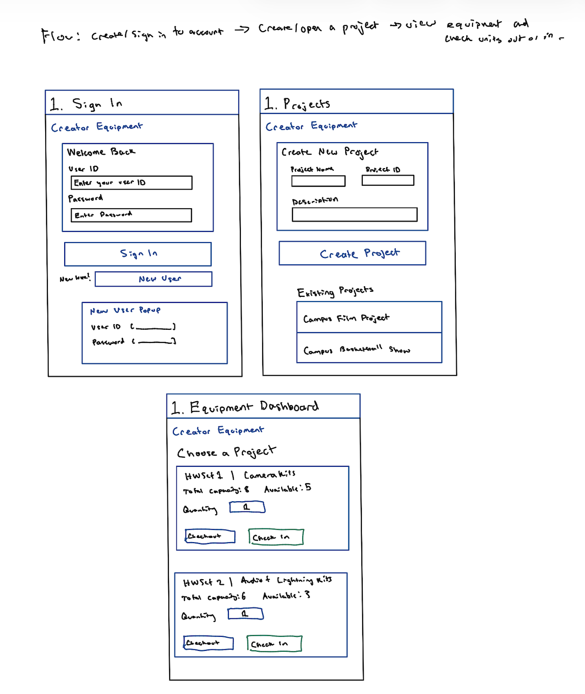

# Project Overview

Creator Equipment as a Service is a web application that helps students and campus organizations manage shared media equipment. Users can create an account and project, view available equipment, check out items for a project, and check them back in when finished.

For our proof of concept, HWSet1 represents camera kits and HWSet2 represents audio and lighting kits. The application will show each set's total capacity and current availability, with the option to add more equipment types later.

## Running Locally

The app has two parts, each with its own README:

- [`server/`](server/README.md): the Flask API and MongoDB data. Run it first, on port 5001.
- [`creator-eaas/`](creator-eaas/README.md): the React page. `npm start` serves it on port 3000 and forwards `/api` requests to the server.

## Project Plan

### Team Members

Kavi Daliparti, Akash Maiti, Shreyas Kumar, Saharsh Lavu, Sanjay Senthil

### Sprint Cadence

We plan to work in one-week sprints. At the beginning of each sprint, we will choose tasks from our GitHub Project board and assign them to team members. At the end of each sprint, we will review completed work and plan the next sprint.

Our initial estimated velocity is 6–8 story points per sprint. We will adjust this estimate after the first sprint based on how much work we actually complete.

### Collaboration and methodology

We will use an Agile approach. GitHub will hold our shared code and documentation, and a GitHub Project board will track planned work. We will use GitHub Issues to track bugs and improvements. Team members will review each other's changes through pull requests and meet regularly to discuss progress and blockers.

### Collaboration Tools

We will use Github, Google Docs, and iMessage as the main forms of collaboration, secondary collaboration tools include Gmail and other Google or Microsoft Suite technologies if needed.

### Implementation Methodology

The React frontend will send requests to the Flask API. The API will read and update information in MongoDB. We will organize account, project, and equipment functions separately so we can add more hardware sets later.

We will first build the required features for two hardware sets: HWSet1 (camera kits) and HWSet2 (audio and lighting kits). Users will be able to sign in, access a project, see equipment availability, and check equipment out and back in.

### Toolchain

| Tool | Planned use |
|---|---|
| React | Build the account, project, and equipment screens. |
| Python and Flask | Create an API for users, projects, equipment status, checkouts, and returns. |
| MongoDB | Store user, project, hardware, and checkout information. |
| PyTest | Test API functions and equipment availability updates. |
| GitHub | Store code and documents, review changes, and track tasks. |
| Cloud hosting | Make the app accessible to the instructor and TAs in a later phase. |

## Product Features

| Feature | What a user can do | Stakeholder needs |
|---|---|---|
| Accounts | Create an account in the New User pop-up, sign in, and sign out. Sign-in lasts 7 days through a signed session cookie. | SN1 |
| Credential protection | Passwords are stored only as salted hashes. User IDs are stored as a keyed hash (for lookups) plus an encrypted copy, never as typed. | SN1 |
| Projects | Start a project with a name, description, and project ID; IDs must be unique. Reopen your projects from the list on the project page. | SN1 |
| Joining by ID | Join someone else's project by typing its exact project ID. Only members can open a project or move its kits. | SN1 |
| Shelf view | See each hardware set's capacity and how many kits are on the shelf, with this project, and with other projects. | SN2 |
| Check out | Request a number of kits for a project. The request is refused if that many aren't on the shelf. | SN3, SN4 |
| Check in | Return kits for a project. A project can't return more than it has out, so availability never passes capacity. | SN5 |
| More hardware sets | Hardware sets are read from the database, so adding an HWSet3 means adding one entry to `server/models/hardware.py`. | SN6 |

### User Stories

User stories are tracked in this repository's Issues tab (#5 through #18).

### Technical Debt

- **Two-step checkouts.** A checkout or check-in updates the hardware set and the project in separate database writes. A crash between them could leave the counts out of step. MongoDB transactions would fix this; they need a replica set, which MongoDB Atlas provides.
- **No way to leave or remove members.** Anyone with a project's ID can join it, and nobody can be removed afterward.
- **The encryption key can't change.** `USERID_ENCRYPTION_KEY` (or `SECRET_KEY`) must stay the same for the life of a deployment, or every existing account is locked out. There's no key rotation.
- **No sign-in rate limiting.** Repeated wrong passwords aren't slowed down or blocked.
- **Placeholder kit contents.** The gear lists in `server/models/hardware.py` are examples, not our real inventory.
- **Extra requests on the project page.** After each checkout or check-in, the page re-fetches the whole project to update its count instead of using the server's reply.

### Research Items

- **Hosting (open, #19 and #37).** The sign-in cookie is `SameSite=Lax`, so the browser won't send it if the React page and the API are on different domains. The page and API either need to be served from one origin, or the cookie needs `SameSite=None` and `Secure` with CORS limited to the page's domain.
- **Database (MongoDB Atlas).** The free tier is enough for the PoC. Accounts and projects can live in separate databases (`USERS_MONGO_URI`, `PROJECTS_MONGO_URI`).
- **Encrypting user IDs.** Settled in #35: a keyed HMAC-SHA256 for lookups plus Fernet (AES) ciphertext, so the stored record never contains the plain user ID.
- **Preventing double checkouts.** Settled: the "enough on the shelf?" check and the decrement are one conditional MongoDB update, so two requests can't both take the last kit.

## High Level Sketch

